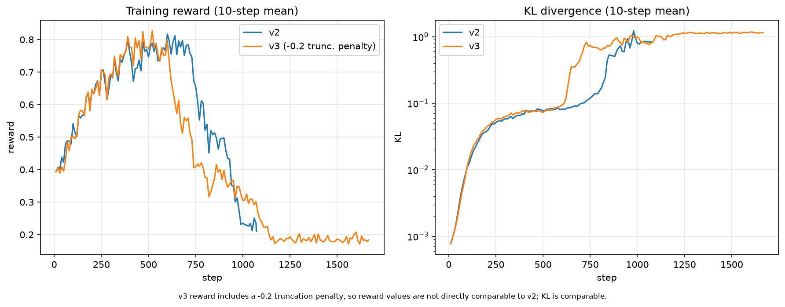
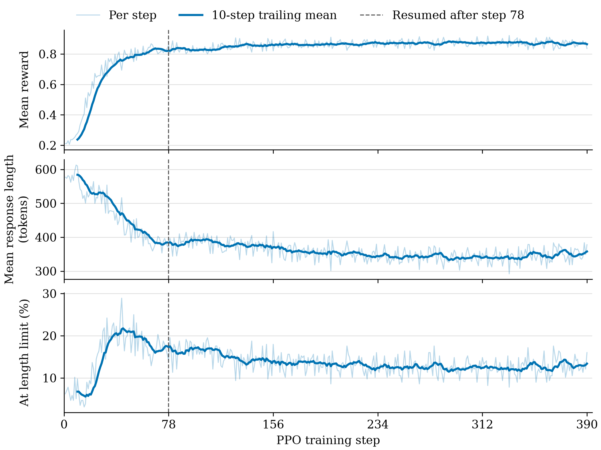
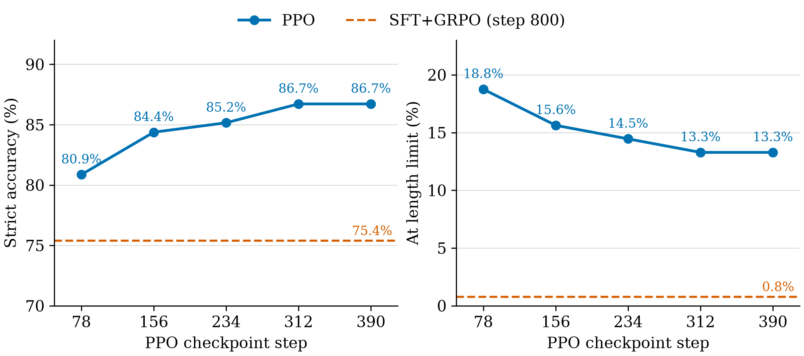

# TinyZero Countdown 复现：GRPO 与 PPO

本项目参考 [TinyZero](https://github.com/Jiayi-Pan/TinyZero) 的 Countdown 任务，用规则奖励训练 Qwen2.5-Instruct。GRPO 使用 ms-swift，PPO 使用 veRL。实验使用生成的 20,000 道训练题和 256 道评估题，面向深度学习课程汇报。

## 实验结果（2026-11-25）

3B 模型的严格正确率从初始的 **23.4%** 升到 SFT 预热后的 **30.9%**。SFT + GRPO 的最佳已评估检查点为第 800 步，正确率 **75.4%（193/256）**。从 3B Instruct 直接起跑的 PPO 跑完了 5 个 epoch，第 312 步和第 390 步以 **86.7%（222/256）** 并列最高，同口径下比最佳 SFT + GRPO 多答对 29 道题。

### Countdown 评估

每个检查点用 Transformers 在同一组 256 道题上贪心生成，每题一条回答，生成上限为 1024 token。严格评分要求 `<answer>...</answer>` 内的算式恰好用指定数字，且算出的值等于目标。截断率按答复重新分词后达到 1024 token 的比例计算。

| 模型或检查点 | 正确率 | 无答案 | 截断 | 平均 token |
|---|---:|---:|---:|---:|
| 1.5B Instruct | 3.1% | 20.7% | 0.8% | 190 |
| 1.5B + GRPO v2 | 10.9% | 0.4% | 0.4% | 50 |
| 3B Instruct | 23.4% | 22.3% | 22.3% | 570 |
| 3B + SFT（457 条样本） | 30.9% | 6.6% | 6.6% | 510 |
| SFT + GRPO v2，500 步实验，第 450 步 | 55.5% | 15.6% | 16.0% | 456 |
| SFT + GRPO v2，全量配置，第 400 步 | 55.5% | 7.0% | 11.3% | 467 |
| SFT + GRPO v2，续训第 500 步 | 62.1% | 6.2% | 6.6% | 430 |
| SFT + GRPO v2，续训第 550 步 | 61.7% | 4.7% | 6.2% | 415 |
| SFT + GRPO v2，续训第 750 步 | 74.6% | 0.4% | 0.4% | 389 |
| **SFT + GRPO v2，续训第 800 步** | **75.4%** | **0.4%** | **0.8%** | **391** |
| SFT + GRPO v2，续训第 850 步 | 71.5% | 0.0% | 1.2% | 400 |
| SFT + GRPO v3，全量配置，第 500 步 | 64.1% | 2.0% | 2.0% | 420 |
| SFT + GRPO v3，全量配置，第 550 步 | 69.5% | 2.0% | 2.0% | 374 |

同一组 256 道题也用于训练期间的验证和检查点选择，最高值可能偏乐观。GRPO 500 步实验的第 450 步改用温度 1.0 采样时，正确率为 50.8%，截断率为 2.0%，无答案率为 2.7%。

### 3B GRPO 训练观察

- 3B 主线先做 SFT，再以 LoRA 训练 GRPO，由 vLLM 为每道题采样 8 条回答。v2 对算对的回答给 1.0 分，对数字合规、可计算但结果错误的回答给 0.3 分。v3 沿用这些分值，对提取不到完整答案且有未闭合答案或思考标记缺失的回答给 −0.2 分。
- v2 从第 400 步续训时清空了 Adam 动量，沿用原学习率调度。v2 第 800 步后正确率回落。导出的逐步训练日志中，v2 和 v3 的 KL 分别在第 940 和第 727 步首次超过 1。v2 和 v3 的训练奖励均值受各自奖励规则影响。
- 更早的一次 SFT + GRPO v2 续训中，同一运行的贪心正确率从第 250 步的 55.9% 降到第 1666 步的 0.0%，末步截断率为 87.1%。延长训练在这套配置下没有带来更好的末步检查点。
- 对贪心回答做关键词统计，3B 初始模型中有 91.4% 的回答含试算或回溯用语，v2 第 800 步为 81.6%。`wait`、`hmm`、`aha`、`actually` 在两者中分别出现在 0.8% 和 0% 的回答里。这项检查只覆盖显式用语，尚未验证模型是否在推理中进行了自我纠正。



逐步训练数值见 [v2/v3 曲线 CSV](results/v2_v3_curves.csv)。

### 3B PPO 训练与复测

从 Qwen2.5-3B-Instruct 直接做全参数 PPO，使用 veRL、GAE 和 vLLM，在 4 张 RTX 4090 上每步生成 256 条回答，每题一条。策略与价值网络的学习率分别为 `1e-6` 和 `1e-5`。在第 78 步恢复模型与优化器状态后再训练 4 个 epoch，累计 **5 个 epoch、390 步**。每轮从同一个 20,000 题训练集取 19,968 道题，跳过最后不足一批的 32 道。



每步统计 256 条训练采样回答。深色曲线为最近 10 步的移动平均，虚线标出第 78 步的续训位置。 [训练指标 CSV](results/ppo_training.csv) · [矢量 PDF](results/ppo_training.pdf)

| 累计轮次 | PPO 检查点 | 严格正确率 | 达到长度上限 | 平均 token |
|---|---:|---:|---:|---:|
| 1 | 78 | 80.9%（207/256） | 18.8% | 391 |
| 2 | 156 | 84.4%（216/256） | 15.6% | 369 |
| 3 | 234 | 85.2%（218/256） | 14.5% | 364 |
| 4 | 312 | **86.7%（222/256）** | 13.3% | 354 |
| 5 | 390 | **86.7%（222/256）** | 13.3% | 358 |



每个点是同一批 256 道题的 Transformers 贪心复测。橙色虚线为 SFT + GRPO 第 800 步的实测值。第 390 步的 veRL 训练内验证使用 vLLM，答对 223 道。 [检查点评估 CSV](results/ppo_checkpoint_eval.csv) · [矢量 PDF](results/ppo_checkpoint_eval.pdf)

第 390 步 PPO 做对了 32 道 SFT + GRPO 做错的题，同时在 3 道后者答对的题上失分。PPO 的正确率更高，仍有 34 条回答达到长度上限。这个结果比较的是两套实际训练配置，起点、全参数训练与 LoRA、奖励规则以及采样量均有差异。要判断两种算法各自的贡献，还需要匹配这些条件的对照和一组独立留出题。

用 Matplotlib 可从 CSV 重画两张图。

```shell
python scripts/plot_ppo_training.py
python scripts/plot_ppo_results.py
```

## 早期 1.5B GRPO 基线（200 步）

以下配置和训练指标对应最初的 1.5B、200 步实验。上面的 1.5B v2 正确率来自后续实验。

### 目录结构

```
gen_countdown.py               # 按 TinyZero 的 Countdown 格式生成训练/测试数据（固定随机种子）
countdown_plugin.py            # ms-swift 自定义奖励函数（规则奖励，与 TinyZero 的 compute_score 一致）
scripts/run_1p5b_grpo.sh       # 训练启动脚本（swift rlhf --rlhf_type grpo）
scripts/export_metrics.py      # 从 TensorBoard 日志导出指标为 CSV
results/metrics_1p5b_grpo.csv  # 200 步训练的全部指标
results/v2_v3_curves.csv       # 3B SFT + GRPO 的逐步奖励和 KL
results/v2_v3_reward_kl.png    # 3B SFT + GRPO 的训练曲线
```

### 环境

- ms-swift 4.6.1，torch 2.15（CUDA 13.2），transformers 5.22.2，trl 0.29.1
- 6 张 RTX 4090（48G）
- 未使用 vLLM，未使用 deepspeed（生成使用 transformers 原生方式）
- 额外依赖：`msgspec`（缺少时启动会报 `ModuleNotFoundError`）

### 复现步骤

```shell
# 1. 生成数据（输出到 data/，约 2 万条训练样本 + 256 条测试样本）
python gen_countdown.py

# 2. 下载基座模型（ModelScope）
modelscope download --model Qwen/Qwen2.5-1.5B-Instruct --local_dir models/Qwen2.5-1.5B-Instruct

# 3. 启动训练（路径需要按你的机器修改）
bash scripts/run_1p5b_grpo.sh

# 4. 查看曲线
tensorboard --logdir output
```

运行前请修改 `scripts/run_1p5b_grpo.sh` 中的路径，并根据机器情况调整 `CUDA_VISIBLE_DEVICES`。

### 奖励设计

与 TinyZero 的 `compute_score` 保持一致：

| 情况 | 奖励 |
|---|---|
| 没有 `<answer>...</answer>` 标签 | 0 |
| 有标签，但数字用法不合规或无法计算 | 0.1 |
| 数字合规，但结果不等于目标值 | 0.1 |
| 数字合规，结果等于目标值 | 1.0 |

### 训练设置

| 参数 | 值 |
|---|---|
| 算法 | GRPO |
| 模型 | Qwen2.5-1.5B-Instruct，全参数训练 |
| 每组采样数 `num_generations` | 8 |
| 最大生成长度 | 1024 |
| 学习率 | 1e-6 |
| KL 系数 `beta` | 0.001 |
| 步数 | 200（约 1 小时） |

### 训练日志（200 步）

数值为前 1/8 与后 1/8 步的平均值。

| 指标 | 前段 | 后段 | 解读 |
|---|---|---|---|
| 奖励均值 `CountdownORM/mean` | 0.117 | 0.123 | 基本未变 |
| 同组奖励全相同的比例 `frac_reward_zero_std` | 0.52 | 0.62 | 上升，无学习信号的组变多 |
| 平均回答长度 | 139 | 144 | 变化很小 |
| 最长回答长度（截断情况） | 889 | 907 | 基本未变 |
| 梯度范数 `grad_norm` | 1.98 | 1.38 | 下降 |
| KL | 0.001 | 0.002 | 模型几乎没有偏离初始状态 |

**结论**：在 200 步、1.5B 模型的设置下，模型没有明显学到 Countdown 的正确解法。奖励 0.1 只表示"格式对但答案错"，奖励均值约 0.12，说明答对的样本比例很低。

数据文件可通过 `gen_countdown.py` 生成。模型权重和训练检查点需要从模型发布方获取或自行复现。
