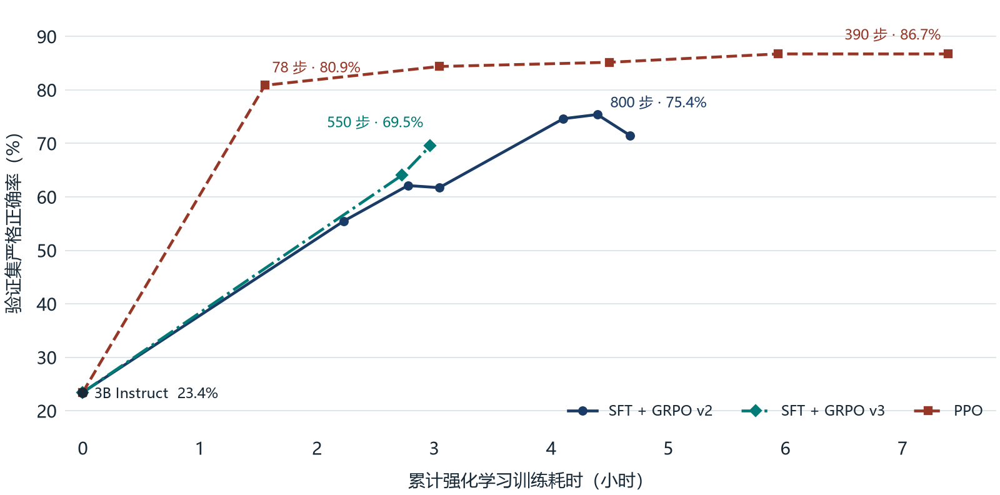
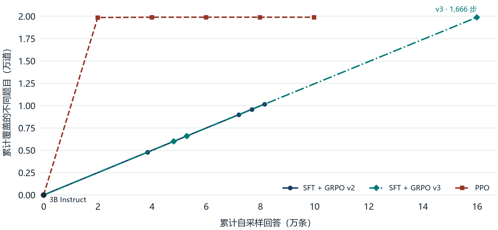
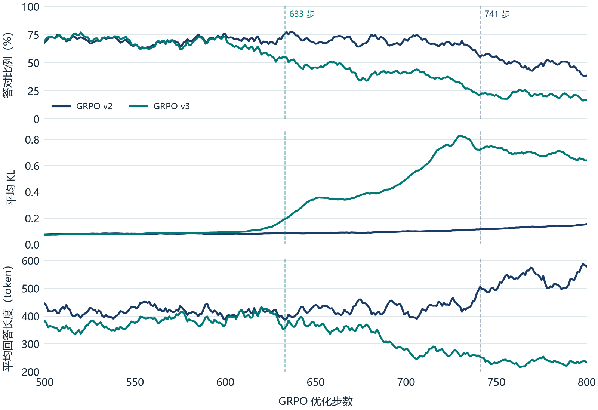

# Countdown 实验报告

## 数据和评估口径

题目要求把给定的 3 个或 4 个数字各用一次，用四则运算凑出目标。训练集有 20,000 条，按数字多重集合与目标去重后有 19,891 道不同题。本页的检查点主表使用原固定 256 道验证题、Transformers 贪心解码和 1024 token 生成上限。严格正确要求 `<answer>...</answer>` 内的算式恰好使用指定数字，且结果等于目标。达到长度上限的比例根据回答重新分词后的长度统计。选点后的结果见[独立测试报告](holdout.md)。

## 训练方式

| 路线 | 学习信号 | 本次配置 |
|---|---|---|
| **SFT** | 用交叉熵学习示范答案的下一个 token。 | 457 条筛选出的示范，覆盖 190 道不同题，训练 2 轮。 |
| **SFT + GRPO** | 同一道题的 8 条回答按组内奖励计算优势，每条回答的有效 token 共用该优势。 | 从 3B SFT 权重起步，ms-swift + vLLM，LoRA rank 16。每步 12 题、96 条回答。两次长程运行的初始学习率均为 `1e-5`，使用余弦衰减。 |
| **PPO** | 规则奖励记在最后一个有效 token 上。用价值网络对当前前缀的预测作为基准，计算各位置的优势。 | 从 3B Instruct 起步，veRL + vLLM，Actor 和 Critic 均全参数训练。每步 256 题、每题 1 条。 |

PPO 的 Actor 是最终用来答题的 Qwen，Critic 从另一份 Qwen 主干起步，接新初始化的 `Linear(2048, 1)` 价值头。规则给完整回答打分后，训练先拟合 Critic 的价值预测，再用已经算好的优势更新 Actor。Critic 和 Actor 的 AdamW 学习率分别为 `1e-5` 和 `1e-6`。每步按 64 条分成 4 个小批次，GAE 使用 `γ=λ=1`，策略裁剪系数为 `0.2`。从第 78 步恢复模型与优化器后继续训练，累计 5 轮、390 步。 [PPO 原论文](https://arxiv.org/abs/1707.06347) · [GRPO 原论文](https://arxiv.org/html/2402.03300#S4.SS1)

GRPO v2 对数字合规、可计算但结果错误的回答给 0.3 分。v3 沿用这一分值，并对提取不到完整答案且答案标记未闭合或思考标记缺失的回答给 −0.2 分。PPO 对有完整答案标签但算错或不合规的回答给 0.1 分。三条路线的训练信号和优化预算都有差异。

## 检查点表现

横轴按各自强化学习训练日志计时。曲线统一以 Instruct 验证正确率为起点。GRPO 在强化学习前经过约 3 分 22 秒的 SFT 预热，横轴未计入该耗时。各条线连接有记录的检查点。[检查点数据](../results/comparison_checkpoints.csv)

| 模型或检查点 | 严格正确率 | 缺少完整答案 | 达到长度上限 | 平均 token |
|---|---:|---:|---:|---:|
| 3B Instruct | 23.4%（60/256） | 22.3% | 22.3% | 570 |
| 3B + SFT | 30.9%（79/256） | 6.6% | 6.6% | 510 |
| SFT + GRPO v2 · 400 步 | 55.5%（142/256） | 7.0% | 11.3% | 467 |
| SFT + GRPO v2 · 500 步 | 62.1%（159/256） | 6.2% | 6.6% | 430 |
| SFT + GRPO v2 · 550 步 | 61.7%（158/256） | 4.7% | 6.2% | 415 |
| SFT + GRPO v2 · 750 步 | 74.6%（191/256） | 0.4% | 0.4% | 389 |
| **SFT + GRPO v2 · 800 步** | **75.4%（193/256）** | **0.4%** | **0.8%** | **391** |
| SFT + GRPO v2 · 850 步 | 71.5%（183/256） | 0.0% | 1.2% | 400 |
| SFT + GRPO v3 · 500 步 | 64.1%（164/256） | 2.0% | 2.0% | 420 |
| SFT + GRPO v3 · 550 步 | 69.5%（178/256） | 2.0% | 2.0% | 374 |
| PPO · 第 1 轮，78 步 | 80.9%（207/256） | 18.8% | 18.8% | 391 |
| PPO · 第 2 轮，156 步 | 84.4%（216/256） | 15.6% | 15.6% | 369 |
| PPO · 第 3 轮，234 步 | 85.2%（218/256） | 14.5% | 14.5% | 364 |
| **PPO · 第 4 轮，312 步** | **86.7%（222/256）** | **13.3%** | **13.3%** | **354** |
| **PPO · 第 5 轮，390 步** | **86.7%（222/256）** | **13.3%** | **13.3%** | **358** |

第 390 步 PPO 做对 32 道最佳 GRPO v2 做错的题，同时在对方答对的 3 道题上失分，净增 29 道。其中，GRPO v2 的 58 道「用数正确、结果错误」题，有 30 道被 PPO 做对。PPO 的 34 道错题都缺少完整答案标签。在训练内 vLLM 验证中，同一 PPO 检查点答对 223 道。主表采用统一 Transformers 结果。

## 题目覆盖与训练成本

PPO 每轮从同一个 20,000 条训练集取 19,968 条，跳过末尾不足一批的 32 条。第一轮生成 19,968 条回答，覆盖 19,859 道不同题。GRPO v2 的最佳验证检查点覆盖 9,581 道题，生成 76,800 条回答。PPO 到第 2 轮已覆盖所有 19,891 道不同题，第 3–5 轮在旧题上重新采样，验证正确率从 84.4% 提到 86.7%。v3 训练末步累计覆盖 19,883 道不同题，生成 159,936 条回答。覆盖图以 Instruct 为起点，统计后续强化学习阶段的采样。

| 实际配置 | 显存预留峰值 | 每步耗时 | 每步回答 | 训练吞吐 | 到该检查点的耗时 |
|---|---:|---:|---:|---:|---:|
| GRPO v2 · 800 步 | 34.70 GiB | 18.9 秒 | 96 | 5.07 条/秒 | 4 小时 24 分 |
| GRPO v3 · 550 步 | 34.16 GiB | 18.6 秒 | 96 | 5.15 条/秒 | 2 小时 58 分 |
| PPO · 78 步 | 45.51 GiB | 71.6 秒 | 256 | 3.58 条/秒 | 1 小时 33 分 |
| PPO · 390 步 | 45.51 GiB | 67.9 秒 | 256 | 3.77 条/秒 | 7 小时 23 分 |

表中的 3B 强化学习运行均使用 4 张 RTX 4090。显存指标为 PyTorch 预留峰值，两个框架的跨卡汇总方式有差异。吞吐包含生成与更新，累计耗时取训练进度日志。PPO 平均每步 Actor 更新约 31.7 秒，Critic 估值与更新合计约 15.0 秒，生成约 10.3 秒。GRPO 每秒处理的回答更多。按题目计算，PPO 首轮每秒约接触 3.6 道题，GRPO 约 0.63 道。

PPO 的完整训练奖励与长度轨迹另见 [曲线](../results/ppo_training.png) · [矢量 PDF](../results/ppo_training.pdf) · [逐步 CSV](../results/ppo_training.csv)。

## 两次 GRPO 退化

曲线用最近 10 步的移动平均，每步有 96 条训练采样回答。训练采样按奖励等于 1 判定答对。两条运行在第 475–775 步读到的题目与顺序一致。 [逐步诊断数据](../results/grpo_instability.csv) · [长程训练奖励与 KL](../results/v2_v3_reward_kl.png)

| 运行与比较区间 | 训练采样答对率 | 平均回答长度 | 达到长度上限 | 平均 KL |
|---|---:|---:|---:|---:|
| v3，576–600 → 726–750 步 | 71.5% → 23.0% | 375 → 248 | 2.7% → 2.2% | 0.091 → 0.763 |
| v2，676–700 → 726–750 步 | 70.0% → 58.6% | 421 → 477 | 3.2% → 9.3% | 0.096 → 0.115 |

- **v3 第 633 步，第 11 组。** 用 `[93, 87, 51]` 凑 `45`。一条回答反复试算到长度上限。全组都答错，其中 4 条因数字合规得到 0.3 分，各自得到约 +0.935 的优势。v2 同步同题 8 条全对。此时 v3 的裁剪前梯度范数为 1.48，KL 已升到 0.222。
- **v2 第 741 步，第 2 组。** 用 `[70, 77, 95]` 凑 `88`。一条回答重复 `95 - 70 - 77 = -52`，写满 1024 token。其余 7 条全对。该步裁剪前梯度范数为 1.13，此前第 735–736 步的奖励已下滑。

样本记录显示，组内全错时，0.3 分错解仍可能有正优势。v3 中出现这种情况的组，从第 576–600 步的 30/300 增到第 726–750 步的 97/300。已有日志只保存整批梯度范数，识别单条回答的因果作用还需要固定样本回放。v2 第 400 步续训时清空了 Adam 动量并沿用原学习率调度。v2 和 v3 的逐步 KL 分别在第 940 步和第 727 步首次超过 1。v3 跑完 1,666 步，累计覆盖 19,883 道题、生成 159,936 条回答，最后 25 步的训练采样仅答对 53/2,400。

补充 GRPO 对照

- 500 步预算的 GRPO v2 在第 450 步贪心评估为 55.5%，缺完整答案 15.6%，达到长度上限 16.0%，平均 456 token。温度 1.0 采样时为 50.8%，缺完整答案 2.7%，达到上限 2.0%。该次学习率在第 500 步降到零。
- 更早的一次 v2 续训，贪心正确率从第 250 步的 55.9% 降到第 1,666 步的 0.0%，末步达到长度上限的比例为 87.1%。

## 回溯与 aha moment

PPO 第 390 步在评估集第 80 题中，用 `[51, 58, 3]` 凑 `41`。它先算出 `58 - 51 + 3 = 10`，明确放弃并继续换方案，最后得到 `58 - 51 / 3 = 41`。同一道题上 SFT 回答无解，GRPO v2/v3 交付了用数合规但结果有误的算式。初始 3B Instruct 在该题上也曾试错并找到同一解。

| PPO 检查点 | 关键词命中 | 回溯候选 | 固定换方案句式 |
|---|---:|---:|---:|
| 78 | 0/256 | 111/256 | 158/256 |
| 156 | 0/256 | 102/256 | 140/256 |
| 234 | 0/256 | 112/256 | 150/256 |
| 312 | 0/256 | 104/256 | 138/256 |
| 390 | 0/256 | 109/256 | 144/256 |

关键词包含 `wait`、`hmm`、`aha`、`actually`。回溯候选要求出现可核算的错解、附近有否定表述且最终答对。该筛选受公式和句式影响。第 390 步的固定句式是 *This doesn't work. Let's try another combination.*。这些例子支持 PPO 会通过反复试算找到正确答案，五个已保存检查点上未观察到反思表述的突增。中间训练步的逐条采样轨迹未留存。 [DeepSeek-R1-Zero 的 aha moment 描述](https://arxiv.org/html/2501.12948#S2.SS3)

早期统计中，3B Instruct 和 GRPO v2 第 800 步的试算或回溯用语分别出现在 91.4% 和 81.6% 的回答里，反思关键词分别命中 2/256 和 0/256。词频与逐题行为分别提供关于表达方式和实际试算过程的证据。

## 结论范围

这组实验支持规则奖励能改善 Countdown 解题表现。PPO 首轮覆盖更多不同题，已超过最佳 SFT + GRPO。两条路线的 SFT 起点、参数更新范围、奖励规则、学习率与采样分配同时变化，算法本身贡献的大小还需匹配条件的对照。

原 256 道题用于验证与检查点选择，有 2 道与训练题完全重合。排除这两道后，所选 PPO 和 GRPO 检查点分别答对 220/254 和 191/254。另行生成的独立测试集与训练和验证题均无重合，两个检查点分别答对 213/256 和 190/256。[独立测试报告](holdout.md)
